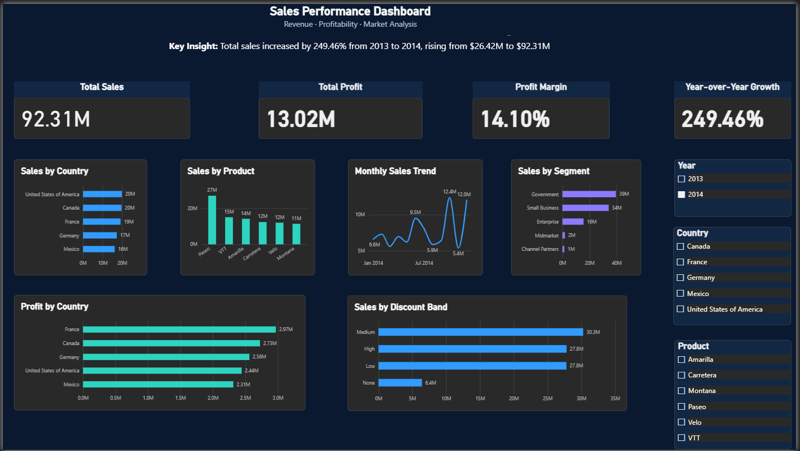

# Sales Performance Dashboard | Power BI

## Project Overview

The **Sales Performance Dashboard** is an interactive business intelligence project built with Microsoft Power BI. It analyzes sales performance, profitability, product performance, customer segments, and discount bands across countries and time.

The dashboard helps users explore key performance indicators (KPIs), identify trends, and compare business performance using interactive filters.

## Objectives

* Analyze total sales and total profit.
* Evaluate profit margin and year-over-year sales growth.
* Compare sales and profit across countries.
* Identify top-performing products and customer segments.
* Examine sales trends over time.
* Compare sales across discount bands.

## Tools & Technologies

* **Microsoft Power BI Desktop** — dashboard development and visualization
* **Power Query** — data preparation and transformation
* **DAX** — measures and time-intelligence calculations
* **Data Modeling** — date table and relationships

## Key Performance Indicators

* Total Sales
* Total Profit
* Profit Margin
* Year-over-Year Sales Growth

## Dashboard Features

* Interactive Year, Country, and Product slicers
* Sales by Country
* Sales by Product
* Monthly Sales Trend
* Sales by Segment
* Profit by Country
* Sales by Discount Band

## Key Insight

For the selected 2014 reporting period, total sales were approximately **$92.31 million**, compared with **$26.42 million in 2013**. This represents an increase of approximately **249.46%**.

## Files

* Sales_Performance_Dashboard.pbix — Power BI project file
* Sales_Performance_Dashboard.png — dashboard screenshot

## Skills Demonstrated

* Data visualization and dashboard design
* Data cleaning and transformation
* DAX measures and time-intelligence calculations
* Data modeling
* KPI analysis
* Business insight communication

## Dataset

This project uses Microsoft's Financial Sample dataset for Power BI practice.

Dataset source: https://learn.microsoft.com/en-us/power-bi/create-reports/sample-financial-download

## Future Improvements

* Add deeper product and regional performance analysis.
* Explore additional profitability and discount metrics.
* Publish an interactive version where appropriate.

